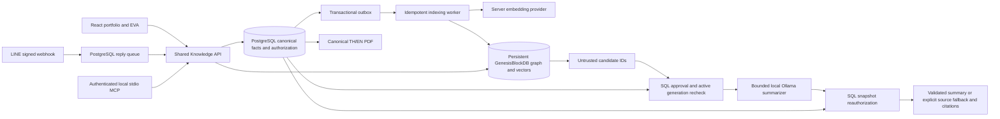

# Architecture and decisions

ADR-001: retain React/Vite. Persistent Node service serves canonical HTML, OG and sitemap plus Vite assets; no Next.js rewrite. Old media sources are preserved. Alternative static-only SPA cannot establish crawlable current authorization; rollback is prior app with AI disabled, never re-enable browser secrets.

ADR-003: immutable reviewed source candidates and per-project generations; SQL outbox and publication changes share one transaction. Approval alone never publishes. `knowledge_index_records` stores references/checksums only. Every native candidate is resolved through canonical joins; no text from Genesis becomes answer context. Publication changes use no-store responses, not a stale response cache. Revocation and model changes invalidate the active gate. Alternative synchronous cross-store writes would falsely imply atomicity.

ADR-004: server-only OpenAI-compatible embedding adapter, bounded timeout/dimension checks. The initial source-excerpt provider remains the explicit fallback. The owner-requested local Ollama adapter now produces a bounded Thai/English sentence with validated source references, exact supporting quotations and a fresh SQL snapshot check after generation. Only server-owned canonical URLs become citations. See [EVA-OLLAMA.md](EVA-OLLAMA.md) for budgets, model benchmark provenance and semantic-grounding limits. No inference keys or private identity enter the browser.

ADR-005: LINE raw-byte signature then durable short-lived reply queue; local stdio official MCP SDK requires a distinct public-read bearer credential. No remote MCP/OAuth service and no public write tools. Owner token is distinct from MCP token. Server authentication is the access boundary; no URL/query grants identity.

ADR-006: PDFKit with vendored OFL Sarabun (SHA256 226d4f368fbc0457990ddef2692679badfd2c1a4e89e5ac4d43c10ba7743b2f1) generates selectable TH/EN text from SQL. PDF responses recheck publication after rendering. No cached/public static personal PDFs. Fixtures explicitly carry a test label. Legacy DOCX and marketing HTML archived under content/legacy. Thai extraction may contain decomposed Sara Am; rendering was inspected.

ADR-007: PostgreSQL plus private persistent Genesis server, API and outbox worker on an always-on host. Compose volumes persist both stores independently. Source pin and verified native binary evidence in GENESIS-CAPABILITIES.md. No raw Genesis public port; no Genesis DB in Vercel Functions. Unpatched upstream transaction/replay graph qualification failed. ADR-008 now qualifies the bounded packaged patch through native ablation and restart. Worker, search and readiness require the matching source commit and build profile at runtime. Readiness also checks SQL connectivity and active collection model/dimension/count/coverage. No REST delete exists: SQL revokes first, cleanup remains an observable blocked outbox event until a qualified replacement-instance rebuild. Physical erasure and whole-volume restore remain separate release gates. Rollback preserves SQL authority; an unqualified runtime cannot serve native answers or activate generations.

[ADR-008](ADR-008-GENESIS-TRANSACTION-IMPACT.md): apply the reviewable engine patch during the source-pinned Docker build; preserve native scoring and WAL ownership. No upstream workspace/release is modified. This repository owns patch review and requalification on upgrades.

See ADR-002-POSTGRES-GENESISBLOCKDB.md for accepted storage authority. No lexical/BM25 lane is introduced.

ADR-009: the public GitHub catalog is an operator-reviewed import artifact, never a static frontend database. Migration 002 stores the observation manifest and curated project narratives in PostgreSQL. The owner's explicit instruction approves public repository facts only. The importer writes approval, sources/chunks, pending generations and outbox events in one transaction; unchanged imports are idempotent and cannot reactivate revoked records. A changed import requires a deliberate revision review instead of silently replacing canonical content. The public catalog query joins current approved project, source, catalog revision and native active-generation state in one SQL snapshot. SSR case studies, sitemap and client rendering use that same service. Source references and editorial lessons are distinguished from personal contribution and runtime evidence.

## Local voice channel (2026-10-31)

The `/voice` client sends bounded PCM16 WAV through two exact allowlisted public routes. A dedicated pinned Lalin CPU worker runs without a network or public port; the API uses its authenticated Unix socket. The same AnswerService retrieves through native Genesis and reauthorizes PostgreSQL evidence after optional speech synthesis. A loopback-only Windows SAPI host provides owner-selected Pattara/Zira voices through a server-only token; Docker reaches it through host.docker.internal. No speech engine is a knowledge authority. Payloads are erased after use, with an idle TTL sweep. See [VOICE-SETUP](VOICE-SETUP.md) for lifecycle and evidence boundaries.
