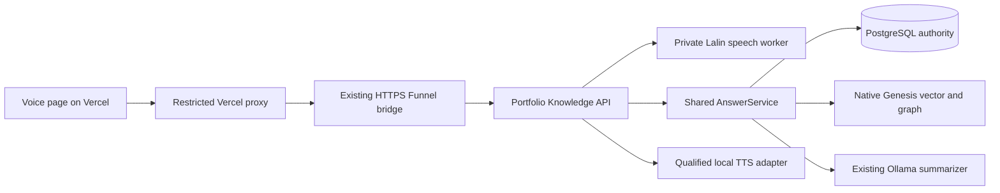

# Zuri Voice Commander design

Date: 2026-10-31 (Asia/Bangkok). Status: owner approved implementation on 2026-10-31; implementation and verification tracked in the plan.

## Intent and selected approach

Visitors ask about approved public portfolio projects using their microphone and receive a concise Thai or English answer, visible citations and spoken playback. The owner selected **local models: Whisper input and tested Thai/English TTS**, and asked to inspect FUNG and Lalin-AI for reuse. See the [pinned reuse audit](../../design/2026-10-31-voice-reuse-audit.md).

Approaches considered:

1. Browser SpeechRecognition/SpeechSynthesis: small installation footprint, but recognition coverage and voice quality vary; recognition can use the browser vendor's remote service. The owner chose local models instead.
2. Local speech models behind the existing API: selected. Reuse Lalin's existing headless worker rather than create a second generic speech engine. This adds bounded CPU/GPU work and needs new audio transport tests.
3. Hosted speech/realtime service: potentially lower maintenance, but adds a provider, credentials and usage costs. Not selected.

The implementation recommendation is a pinned Lalin ASR worker with a portfolio-owned adapter, borrowing FUNG's persistent-model and validation patterns. After hearing generated samples, the owner additionally selected Windows Pattara for Thai and Zira for English as the initial public voices. Native generation, authenticated Docker reachability and hosted playback are separate gates.

## Visitor flow and UI

- Add `/voice` with a restrained layout matching the existing quiet portfolio, a visible Thai/English input-language selector, microphone start/stop, editable transcript, send, answer and citation links, replay/stop audio and clear-session controls.
- Add a discoverable Voice link in site navigation/Contact while preserving existing “คุยกับ Zuri ผ่าน LINE” links and their destination. Do not restore the former EVA modal.
- Use a button to start each recording; stop automatically at 15 seconds, and stop microphone tracks on cancel, tab hiding or leaving the route. No wake word or continuously open microphone.
- Browser captures microphone audio using standard media APIs and produces bounded mono PCM16 WAV at 16 kHz. Stop playback before recording to avoid capturing Zuri's own voice. Explicitly support or explain unavailable capture on the user's browser.
- Use the chosen language as the ASR language, rather than assuming automatic Thai detection works. Visitors can correct the transcript before sending it. Answers continue to use the existing question-language policy.
- Show separate recording/transcribing/answering/ready states. On denial, unsupported media, silence or unavailable models, provide a useful localized message and a text field. Do not silently send audio to a cloud provider or switch TTS engines.
- Speak only the validated answer text. Keep full citation titles and clickable URLs visible; do not read long URLs aloud. Clearly mark source-excerpt fallback if summarization failed.
- Session messages and audio playback objects remain in page memory and are cleared on request/navigation. No voice cloning, reference-voice upload, hiring commitments, booking or computer-command tools in this feature.

## System boundaries

Canonical portfolio data, source provenance, publication and authorization stay in PostgreSQL. Genesis remains the mandatory persistent native vector+graph engine; no pgvector or speech-owned knowledge store. No voice conversations are ingested as approved knowledge.

Lalin worker receipts are private, bounded engine-control records, never portfolio authorization or knowledge provenance. A new portfolio turn's access token/citation proof, if needed, belongs in PostgreSQL. Do not import FUNG's Genesis-as-application-authority model into this project.

Run a dedicated worker instance owned by this feature, pinned to the audited Lalin commit. Its models mount read-only, its control socket is private, its service token stays server-only, and CPU/memory limits are explicit. Do not borrow another application's running worker, credentials, media or database. No model downloads during visitor requests. No changes to the Lalin/FUNG source checkouts are required.

## Proposed public API

These are new portfolio-owned routes, not claimed existing Lalin endpoints. Add schemas and negative tests before enabling the exact allowlist paths in both Vercel and the persistent bridge.

1. `POST /api/voice/transcribe?lang=th|en`: raw `audio/wav`, at most 512 KiB and 15 seconds. Validate actual WAV structure, PCM16, mono, sample rate and duration before inference. Return `{text, language}` or explicit silence/unavailable/error status. No client file paths or URLs. ASR deadline at most 20 seconds with a warmed worker; fail clearly rather than extending it silently.
2. `POST /api/voice/reply`: bounded JSON `{message, lang}`. Call the existing AnswerService and return its answer, citations and status plus bounded audio when a qualified TTS provider is ready. Audio representation is a WAV base64 field with explicit MIME type, at most 2 MiB decoded; the client creates a local Blob URL. No arbitrary public text-to-speech endpoint.

The second route keeps answer and audio tied to the same server-generated text. TTS failure returns the original answer and citations with `audio_status: unavailable`; it must not fabricate playback success. The AnswerService must provide a server-internal evidence proof so publication can be checked again after synthesis, immediately before returning text/audio. A revocation invalidates both. No raw node text or internal authorization proof is returned to the browser.

The reply route stays within the existing 25-second upstream / 30-second Vercel function budget: existing answer synthesis at most 12 seconds, TTS at most 8 seconds, bounded remaining time for retrieval/authorization/transport. Enforce a single end-to-end deadline; do not sum unbounded operations. If these measured budgets cannot support usable TTS on this host, keep audio unavailable and record the unresolved gate rather than relaxing production timeouts without review.

Exact worker submission/status/cancel/output/erase endpoints are verified in the audit. The adapter discovers/pins the actual profile revision and worker epoch, supplies the required issuer/admission envelope, polls within its deadline and erases input/output after consumption. Cancellation must stop the owned operation, not just the browser fetch; expired/disconnected work also has a server-side deadline and cleanup.

No public worker management, raw Ollama, file download, arbitrary preset, model selection, shell, desktop or MCP routes. Keep the existing LINE signature-only exception intact. Carry bounded binary requests and approved audio responses only on the new exact voice paths; existing public JSON/PDF restrictions remain in force elsewhere.

## Resource, privacy and abuse choices proposed by the implementer

- Initial ASR candidate: Lalin's pinned large-v3-turbo CPU int8 profile with VAD and one inference at a time. Start with four CPU threads on this six-core i7-8700K, measure under the actual portfolio workload and adjust within six. The existing medium cache is a diagnostic candidate, not a qualified Thai fallback.
- Never unload another app's models or claim a process-local semaphore schedules the entire GPU. Preserve the existing Qwen web/LINE runtime. TTS is serialized within this feature and has a short deadline; busy returns text with audio unavailable.
- Dedicated private containers/volumes, model pins, health/readiness, restart policy and rollback. No database migration is needed for raw speech payloads; do not store them in portfolio tables. Any minimal turn/proof table must have a short TTL and no raw recording.
- Delete recordings and generated audio immediately after transfer/cancellation, with a maximum one-minute residual TTL and a restart cleanup sweep. Verify the actual worker TTL and janitor timing; do not inherit its 24-hour default unnoticed. Omit payload text/audio and credentials from logs. Return `no-store` on voice responses.
- Add per-client and global admission limits before accepting body bytes; shared-host capacity is one ASR job plus a small bounded queue or explicit busy response. IP identity must be derived only from the trusted deployment path, not visitor-provided forwarding headers.
- Show the microphone processing disclosure before capture. Audio goes to this portfolio's local speech service; no third-party recognition by default. Update `/privacy` to cover temporary speech processing and the lack of conversation retention.

## TTS gate

The installed Qwen TTS-named tag failed actual speech output requests in both languages. Lalin F5 has historical synthesis evidence, but its checked-in preset is Thai-only and `dev-only`. Neither can currently be described as the working public TH/EN TTS provider.

Owner addendum (2026-10-31): “ใช้ Pattara/Zira ไปก่อน”. Use the installed Windows System.Speech voices, not F5 cloning or the failed Ollama tag. A loopback-only authenticated host receives server-generated answer text, invokes PowerShell 7 through stdin, and returns bounded PCM16/24-kHz WAV. PowerShell 7 is required on this machine to enumerate Pattara; Windows PowerShell 5 exposes only the Desktop English voices. No microphone/reference recording is used to create these presets. Keep speech on this machine and preserve explicit unavailable fallback on process/voice failures. F5 remains an optional future provider, not a prerequisite for this approved initial voice choice. No cloud fallback is authorized.

Text and ASR slices may be implemented independently. The full requested spoken experience remains incomplete until TTS clears this gate. Do not deploy a page claiming bilingual spoken replies while returning only text.

## Acceptance and evidence

1. Unit/protocol tests for media bounds, WAV parsing, profile/epoch mismatch, unapproved presets, token isolation, deadline/cancel/erase, refusal to synthesize client-supplied arbitrary text, same-text audio binding and post-TTS SQL revocation.
2. Real local ASR TH/EN clips with known transcripts; silence/noise must not cause an LLM call. Record model hashes, effective device, elapsed time and recognized text separately from mock tests.
3. Real shared PostgreSQL + native Genesis + Ollama answers in Thai and English with correct approved citations; held/private facts abstain. Never call fixture search a native test.
4. Real TTS WAV generation and audible listening in both languages; transcription round trips are diagnostic, not a substitute for listening or human transcription references.
5. Real Vercel browser flow: recording consent, capture/stop, transcript edit, answer/citations, playback/stop, navigation cleanup, microphone denial and text fallback; desktop plus physical-phone capture/playback recorded separately. Fake browser media does not prove microphone hardware.
6. Verify existing project pages, LINE links and signed webhook behavior after deployment. No voice model/provider service appears in the public bundle or public network allowlist.
7. Preserve failures and distinguish source inspection, historical evidence, diagnostic probes, new tests, actual hosted behavior and owner listening acceptance.

## Review boundary

Before implementation planning, review this proposal's public flow and local service boundary. The owner-selected Windows presets close voice selection; actual hosted output and physical device acceptance remain separate verification gates. Builder may settle component names, small styling decisions and private HTTP client mechanics without changing the above boundaries. No paid infrastructure or replacement of LINE OA is part of this work.

## Implementation sizing ruling (2026-10-31)

The initial ASR choice was explicitly a candidate, not a requirement to ship turbo on unsuitable hardware. Real production-path turbo checks hit the unchanged deadline. Select pinned Whisper Small CPU int8 / four threads / beam five for this host after same-fixture native timing comparison; preserve larger-model failures and manual transcript review. This lowers memory and latency at a potential accuracy cost. It does not change the owner’s local Whisper choice, language selection, publication policy or TTS presets. Natural speech quality remains a separate device/owner gate.
